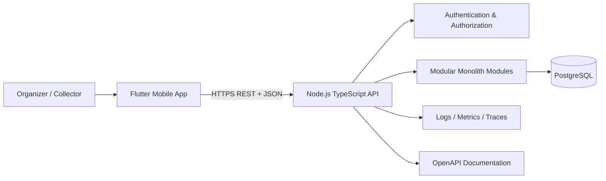

# 02 — High-Level Design (HLD)

## 1. Architecture decision

Use a **modular monolith**: one deployable Node.js backend with clear internal modules, one PostgreSQL database, and a Flutter client. Do not split into microservices for the MVP. Module boundaries must make future extraction possible without adding distributed-system complexity now.

## 2. System context

## 3. Backend modules

- **Identity:** accounts, sessions/tokens, profile.
- **Workspace/Access:** workspace membership, roles, committee-level grants.
- **Committees:** committee lifecycle, configuration versions, schedule rules.
- **Members:** member records and committee membership.
- **Schedule:** obligation generation, due dates, schedule previews.
- **Ledger:** collections, allocations, reversals, derived outstanding amounts.
- **Reports:** summary queries, member statements, exports.
- **Audit:** append-only audit events.
- **Notifications (optional MVP):** in-app reminders only; external SMS/push providers are future adapters.
- **Shared Kernel:** IDs, money type, date/time utilities, error types, pagination, result types.

Each module owns its application use cases and persistence access. Other modules call exported application interfaces, not each other's database repositories directly.

## 4. Technology choices

- Flutter + Dart for mobile app.
- Node.js LTS runtime + TypeScript strict mode.
- PostgreSQL as authoritative data store.
- REST/JSON API documented with OpenAPI 3.1.
- SQL migrations managed by a migration tool.
- Structured logging; error monitoring; metrics.
- Containerized backend deployment.
- Secrets supplied through environment/secret manager, never committed.

Exact library choices (HTTP framework, ORM/query builder, auth provider, migration tool, logging library) are implementation decisions that must be recorded in ADRs. Prefer mature, well-supported tools and avoid unnecessary dependencies.

## 5. Request flow: record collection

1. Flutter validates basic form input and sends POST request with an idempotency key.
2. API authenticates user and checks role access to the target committee.
3. Collection use case loads relevant obligations under a transaction with concurrency-safe locking.
4. Server validates member/committee consistency, amount, allocation policy, and any partial-payment rules.
5. In one PostgreSQL transaction, create collection, allocation rows, audit event, and any idempotency result.
6. Commit transaction.
7. Return canonical collection and updated obligation statuses/balances.
8. Client refreshes affected calendar cells, member list, and summary. Client does not invent the balance.

## 6. Data ownership and source of truth

PostgreSQL is authoritative. Flutter local state is a cache for presentation, not the source of financial truth. Outstanding amounts and statuses are derived from persisted obligations, allocations, and reversals. Avoid storing multiple independently editable copies of the same balance.

## 7. Security boundaries

- Every request is authenticated except explicitly public health endpoints.
- Every committee resource request checks access server-side.
- Tenant/workspace scope is included in database access paths.
- Collection writes are transactional and retry-safe.
- Database credentials are least-privilege.
- Audit records do not contain secrets.
- Backups are encrypted and restore-tested.

## 8. Deployment topology

MVP:
- Flutter app distributed through internal testing and app stores when ready.
- One stateless API service with multiple replicas if needed.
- Managed PostgreSQL with backups and restricted network access.
- Optional managed object storage only if export files are generated and need temporary storage.
- CI runs formatting, static analysis, tests, migrations validation, and build checks.

## 9. Architecture constraints

- No wallet, payment processing, or money custody in MVP.
- No microservices or event broker unless a measured need appears.
- No direct database access from Flutter.
- No business rules implemented only in UI.
- No floating-point financial arithmetic.
- No destructive deletion of financial history.
- Avoid circular module dependencies.
