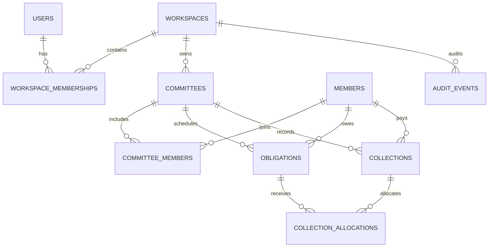

# 04 — Domain Model and Database Design

## 1. General rules

- PostgreSQL is the source of truth.
- Use UUID primary keys unless a recorded ADR justifies otherwise.
- Store monetary values as `BIGINT` minor units (NPR paisa); do not use `FLOAT`, `REAL`, or `DOUBLE PRECISION`.
- Use `TIMESTAMPTZ` for event timestamps and `DATE` for due dates.
- Include `created_at`, `updated_at` where applicable, and `created_by` for important user actions.
- Add `workspace_id`/tenant scope to relevant records and indexes.
- Use foreign keys and constraints; application validation alone is insufficient.
- Use append-only ledger/audit events for financial history.

## 2. Proposed tables

### `users`
- `id UUID PK`
- `display_name TEXT NOT NULL`
- `email TEXT NULL UNIQUE` (if email auth is used)
- `phone_e164 TEXT NULL UNIQUE` (if phone auth is used; uniqueness rules must account for nulls)
- `auth_subject TEXT UNIQUE` (if external auth provider)
- `status TEXT NOT NULL`
- `created_at TIMESTAMPTZ NOT NULL`
- `updated_at TIMESTAMPTZ NOT NULL`

### `workspaces`
- `id UUID PK`
- `owner_user_id UUID FK users`
- `name TEXT NOT NULL`
- `created_at TIMESTAMPTZ NOT NULL`

### `workspace_memberships`
- `workspace_id UUID FK`
- `user_id UUID FK`
- `role TEXT NOT NULL` (`OWNER`, `ADMIN`, `COLLECTOR`, `VIEWER`)
- `status TEXT NOT NULL`
- `created_at TIMESTAMPTZ NOT NULL`
- PK `(workspace_id, user_id)`

### `committees`
- `id UUID PK`
- `workspace_id UUID FK`
- `name TEXT NOT NULL`
- `status TEXT NOT NULL` (`DRAFT`, `ACTIVE`, `COMPLETED`, `ARCHIVED`)
- `currency_code CHAR(3) NOT NULL DEFAULT 'NPR'`
- `timezone TEXT NOT NULL DEFAULT 'Asia/Kathmandu'`
- `start_date DATE NOT NULL`
- `end_date DATE NULL`
- `duration_count INTEGER NOT NULL`
- `duration_unit TEXT NOT NULL` (`DAY`, `MONTH`)
- `frequency TEXT NOT NULL` (`DAILY`, `WEEKLY`, `MONTHLY`, `CUSTOM`)
- `contribution_amount_minor BIGINT NOT NULL CHECK (contribution_amount_minor > 0)`
- `schedule_rule JSONB NOT NULL`
- `allocation_policy TEXT NOT NULL`
- `allow_partial_payment BOOLEAN NOT NULL DEFAULT false`
- `allow_unallocated_credit BOOLEAN NOT NULL DEFAULT false`
- `config_version INTEGER NOT NULL DEFAULT 1`
- `created_by UUID FK users`
- `created_at TIMESTAMPTZ NOT NULL`
- `updated_at TIMESTAMPTZ NOT NULL`

### `committee_config_versions`
- `id UUID PK`
- `committee_id UUID FK`
- `version INTEGER NOT NULL`
- `config_snapshot JSONB NOT NULL`
- `effective_from DATE NOT NULL`
- `created_by UUID FK users`
- `created_at TIMESTAMPTZ NOT NULL`
- UNIQUE `(committee_id, version)`

### `members`
- `id UUID PK`
- `workspace_id UUID FK`
- `display_name TEXT NOT NULL`
- `phone TEXT NULL`
- `external_reference TEXT NULL`
- `notes TEXT NULL`
- `status TEXT NOT NULL`
- `created_by UUID FK users`
- `created_at TIMESTAMPTZ NOT NULL`
- `updated_at TIMESTAMPTZ NOT NULL`

### `committee_members`
- `committee_id UUID FK`
- `member_id UUID FK`
- `membership_status TEXT NOT NULL` (`ACTIVE`, `INACTIVE`)
- `joined_at DATE NOT NULL`
- `left_at DATE NULL`
- `member_config JSONB NOT NULL DEFAULT '{}'`
- PK `(committee_id, member_id)`

### `obligations`
- `id UUID PK`
- `workspace_id UUID FK`
- `committee_id UUID FK`
- `member_id UUID FK`
- `due_date DATE NOT NULL`
- `due_amount_minor BIGINT NOT NULL CHECK (due_amount_minor >= 0)`
- `currency_code CHAR(3) NOT NULL`
- `schedule_version INTEGER NOT NULL`
- `status_cache TEXT NULL` (optional cache only; derived state remains authoritative)
- `created_at TIMESTAMPTZ NOT NULL`
- UNIQUE `(committee_id, member_id, due_date)` unless schedule explicitly allows multiple obligations per day.

### `collections`
- `id UUID PK`
- `workspace_id UUID FK`
- `committee_id UUID FK`
- `member_id UUID FK`
- `amount_minor BIGINT NOT NULL CHECK (amount_minor > 0)`
- `currency_code CHAR(3) NOT NULL`
- `received_at TIMESTAMPTZ NOT NULL`
- `method_label TEXT NULL` (e.g. cash; informational only)
- `reference TEXT NULL`
- `note TEXT NULL`
- `recorded_by UUID FK users`
- `recorded_at TIMESTAMPTZ NOT NULL`
- `reversal_status TEXT NOT NULL DEFAULT 'ACTIVE'`

### `collection_allocations`
- `id UUID PK`
- `workspace_id UUID FK`
- `collection_id UUID FK collections`
- `obligation_id UUID FK obligations`
- `amount_minor BIGINT NOT NULL CHECK (amount_minor > 0)`
- `created_at TIMESTAMPTZ NOT NULL`
- `created_by UUID FK users`

### `ledger_adjustments`
- `id UUID PK`
- `workspace_id UUID FK`
- `committee_id UUID FK`
- `member_id UUID FK`
- `obligation_id UUID NULL FK`
- `collection_id UUID NULL FK`
- `adjustment_type TEXT NOT NULL`
- `amount_minor BIGINT NOT NULL`
- `reason TEXT NOT NULL`
- `created_by UUID FK users`
- `created_at TIMESTAMPTZ NOT NULL`

### `idempotency_records`
- `id UUID PK`
- `workspace_id UUID FK`
- `actor_id UUID FK users`
- `idempotency_key TEXT NOT NULL`
- `request_hash TEXT NOT NULL`
- `response_status INTEGER NOT NULL`
- `response_body JSONB NOT NULL`
- `created_at TIMESTAMPTZ NOT NULL`
- UNIQUE `(workspace_id, actor_id, idempotency_key)`

### `audit_events`
- `id UUID PK`
- `workspace_id UUID FK`
- `actor_id UUID FK users`
- `action TEXT NOT NULL`
- `entity_type TEXT NOT NULL`
- `entity_id UUID NOT NULL`
- `reason TEXT NULL`
- `metadata JSONB NOT NULL DEFAULT '{}'`
- `created_at TIMESTAMPTZ NOT NULL`

## 3. Important database constraints

1. Allocation's collection and obligation must refer to the same workspace, committee, and member. Enforce through composite foreign keys where practical, or robust transaction-level checks plus appropriate constraints.
2. The sum of allocations must not exceed the collection amount. Because this is an aggregate constraint, enforce in a transaction with row locks; optionally use a deferred constraint trigger if the team can maintain it safely.
3. Total active allocations against an obligation must not exceed its adjusted due amount unless approved credit behavior is implemented.
4. Financial records are not physically deleted through application operations.
5. Every reversal references the original record and includes a reason.
6. Use indexes for common queries: `(committee_id, due_date)`, `(committee_id, member_id, due_date)`, `(member_id, received_at DESC)`, `(workspace_id, created_at DESC)`, and audit entity lookup.
7. Use migration files with forward migration and a documented rollback/recovery approach.

## 4. Entity relationships

## 5. Example: missed five due dates, pays lump sum on the 26th

Suppose five previous due obligations remain unpaid and the member records a collection of NPR 12,000 received on the 26th.

- Create one collection with `received_at` on the 26th.
- Create allocation rows against each due obligation actually covered.
- Do not modify the due dates or claim that the money was received on those historical dates.
- Each fully settled obligation becomes `PAID_LATE` if its final settlement was after its due date.
- A partially covered obligation remains partial with its remaining amount.
- The statement shows both due date and actual received date.
- Calendar cells for historical dues are orange only when fully paid late; if still outstanding they remain red with the remaining amount.

The example amount is illustrative; the allocation preview must calculate from real configured due amounts and must never force a guessed split.

## 6. Schedule generation

Generate a preview before activation. Persist obligation rows for the active schedule. For long or custom schedules, generation can be chunked but must be deterministic and idempotent.

Schedule rule examples:
- `DAILY`: every calendar day between start/end.
- `MONTHLY`: a configured day-of-month.
- `CUSTOM`: explicit date list or rule.

The handling of month-end dates, holidays, non-working days, and schedule edits is an open product decision. Do not invent a silent default. Store the chosen rule in `schedule_rule` and snapshot it in `committee_config_versions`.

## 7. Data retention and deletion

- Financial history must remain auditable.
- Deactivate members and archive committees rather than deleting records that have financial history.
- Define account deletion/export and retention policy after legal review.
- Backups must be encrypted and access restricted.
